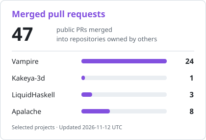

# Hi, I'm Pietro

### Automated reasoning, formal verification, and AI for mathematics

I'm a CS student at the University of Naples Federico II and an AI researcher at [Project Numina](https://projectnumina.ai). I work on theorem proving and model checking, contribute to [Vampire](https://github.com/vprover/vampire), and build [Fang](https://github.com/shalashaska117/Fang), a first-order theorem prover in Rust with Lean 4 proof checking.

  

Open to internship and research opportunities.

## At Numina

I work on automating mathematics and autoformalization with [Numina Fuse](https://fuse.projectnumina.ai). I also worked on Numina's public [Lean 4 formalization of the three-dimensional Kakeya conjecture](https://github.com/project-numina/kakeya-3d).

 

## Open source

<a href="https://github.com/search?q=is%3Apr+is%3Amerged+is%3Apublic+author%3Ashalashaska117+-user%3Ashalashaska117&amp;type=pullrequests"><picture><source media="(prefers-color-scheme: dark)" srcset="profile/merged-prs-dark.svg"></picture></a> <a href="https://github.com/shalashaska117?tab=overview"><picture><source media="(prefers-color-scheme: dark)" srcset="profile/stats-dark.svg"></picture></a>

The cards refresh daily. The PR card counts public PRs merged into repositories owned by other users or organizations; the stats card covers my public GitHub activity.

### Vampire

I contribute correctness fixes and refactors to the [Vampire theorem prover](https://github.com/vprover/vampire). My merged work includes:

- Fixing a wrong answer involving Boolean `$let` expressions ([#894](https://github.com/vprover/vampire/pull/894)) and Euclidean division in the Z3 integration ([#1025](https://github.com/vprover/vampire/pull/1025)).
- Making container hash functions explicit and removing `DefaultHash` ([#935](https://github.com/vprover/vampire/pull/935)).
- Fixing SMT proof reconstruction ([#971](https://github.com/vprover/vampire/pull/971)) and removing a timer-thread read of shared options ([#1027](https://github.com/vprover/vampire/pull/1027)).

[Browse my merged Vampire PRs →](https://github.com/vprover/vampire/pulls?q=is%3Apr+author%3Ashalashaska117+is%3Amerged)

### Other contributions

- [Kakeya-3d](https://github.com/project-numina/kakeya-3d): work on the Lean 4 formalization of the three-dimensional Kakeya conjecture at Numina. [Merged PRs](https://github.com/project-numina/kakeya-3d/pulls?q=is%3Apr+author%3Ashalashaska117+is%3Amerged).
- [LiquidHaskell](https://github.com/ucsd-progsys/liquidhaskell): recursive datatype autosize measures and validation of PLE annotations. [Merged PRs](https://github.com/ucsd-progsys/liquidhaskell/pulls?q=is%3Apr+author%3Ashalashaska117+is%3Amerged).
- [Apalache](https://github.com/apalache-mc/apalache): type checking, expression simplification, and module importing in the TLA+ model checker. [Merged PRs](https://github.com/apalache-mc/apalache/pulls?q=is%3Apr+author%3Ashalashaska117+is%3Amerged).
- [Lean Explore benchmarks](https://github.com/lean-explore/lean-explore-bench): offline benchmarks and candidate selection experiments for Lean 4 search. [Merged PRs](https://github.com/lean-explore/lean-explore-bench/pulls?q=is%3Apr+author%3Ashalashaska117+is%3Amerged).

## Personal projects

### Fang

<a href="https://github.com/shalashaska117/Fang"><picture><source media="(prefers-color-scheme: dark)" srcset="profile/fang-dark.svg"></picture></a>

An experimental first-order theorem prover written in Rust. Fang reads TPTP problems and checks the proofs it finds with an independent Lean 4 checker before reporting success. It supports TSTP proof output; improving proof search is the current focus.

[Source and documentation →](https://github.com/shalashaska117/Fang)

### More projects

- [ATL Model Checker](https://github.com/shalashaska117/atl-model-checker): strategic verification of multi-agent systems with Alternating-time Temporal Logic. `Python`
- [Logic Evaluator](https://github.com/shalashaska117/logic-evaluator): propositional logic parser and Boolean minimizer with Quine-McCluskey, Petrick's method, and Karnaugh maps. `Python`
- [RegexRiddle](https://github.com/shalashaska117/RegexRiddle): a web game for practising regular expressions. `TypeScript · Vue · Express · PostgreSQL`
- [DietiEstates25](https://github.com/shalashaska117/DietiEstates25): a real estate platform with geospatial search. `Java · Spring Boot · React · PostGIS`
- [Labyrinth Game](https://github.com/shalashaska117/labyrinth-game): a multiplayer maze game with a TCP client-server architecture. `C · UNIX sockets`

More on my [portfolio](https://www.pietropellegrino.dev).

## Technologies I've used

### Programming languages

          

### Proof assistants and verification tools

     

### Web frameworks and databases

        

### Development, testing, and writing

     

Cards: <a href="https://github.com/stats-organization/github-stats-extended">GitHub Stats Extended</a>. <a href=".github/profile-cards.md">How the cards update</a>.
